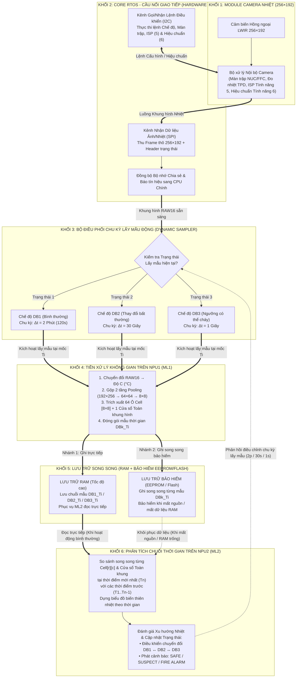
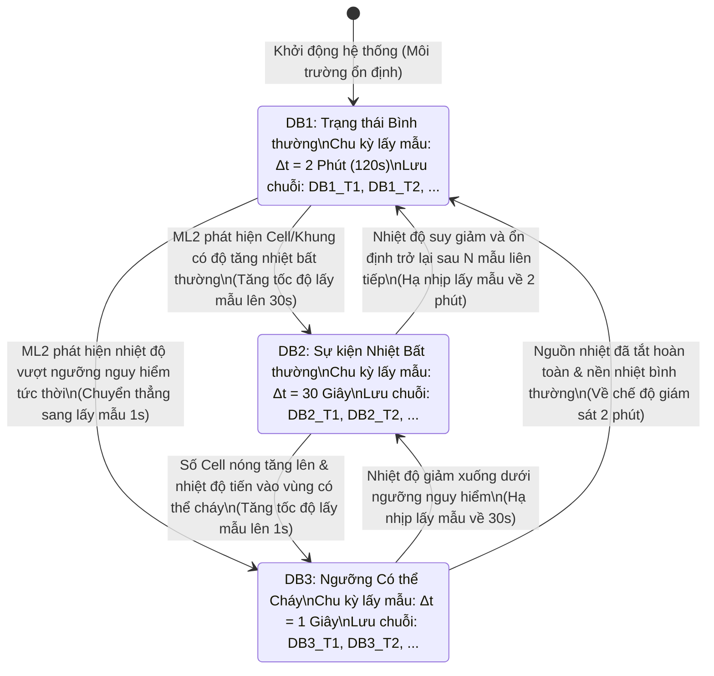
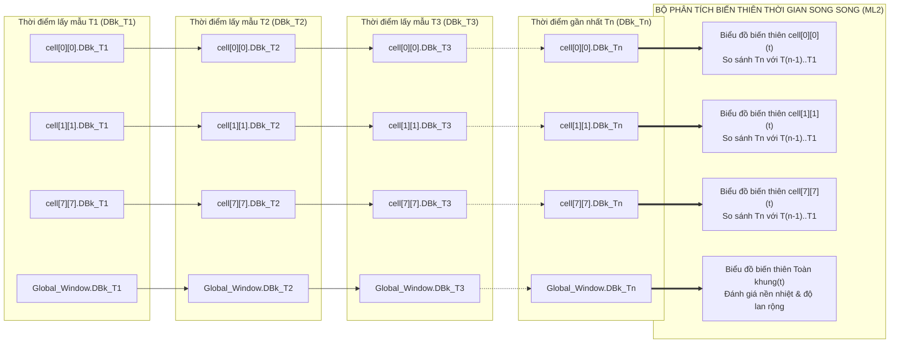
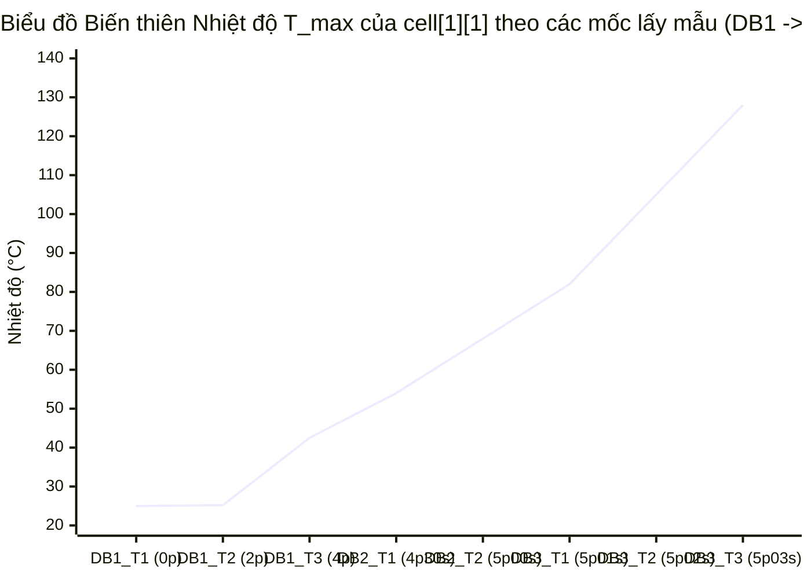
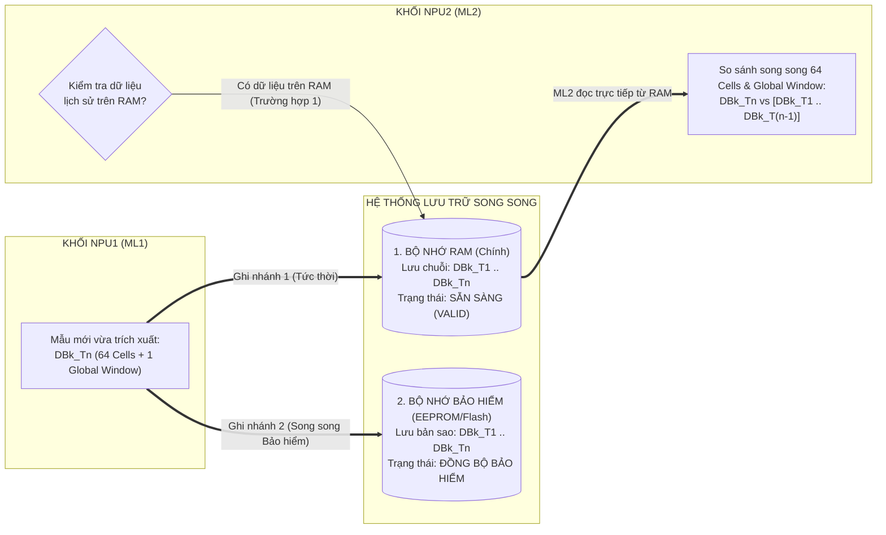
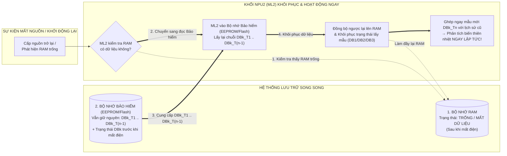
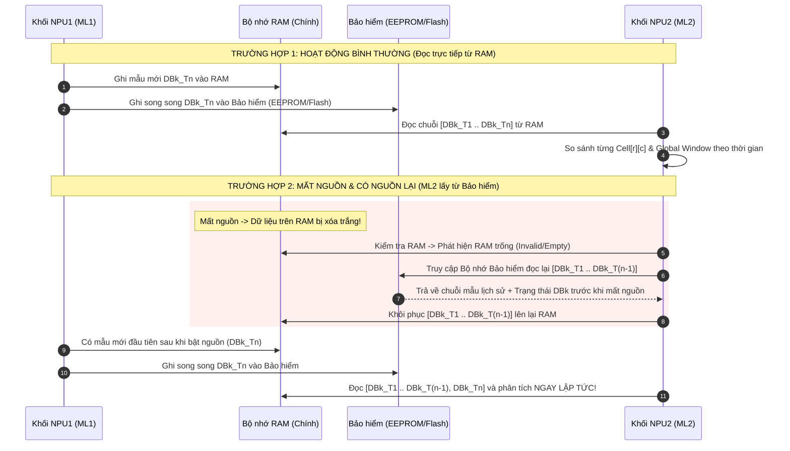
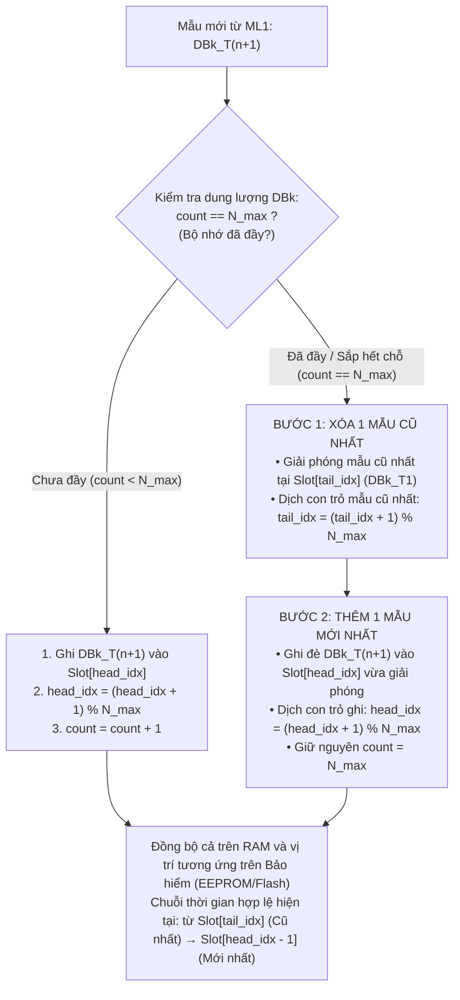
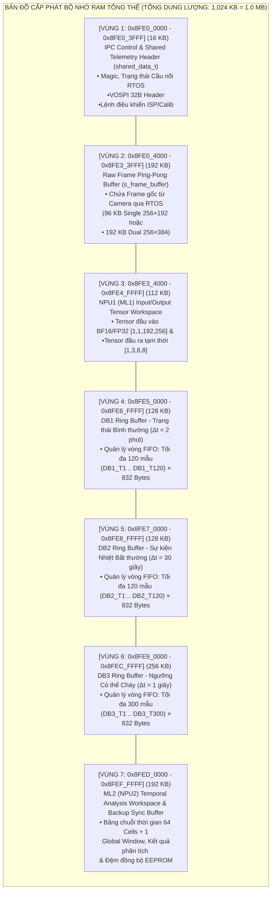
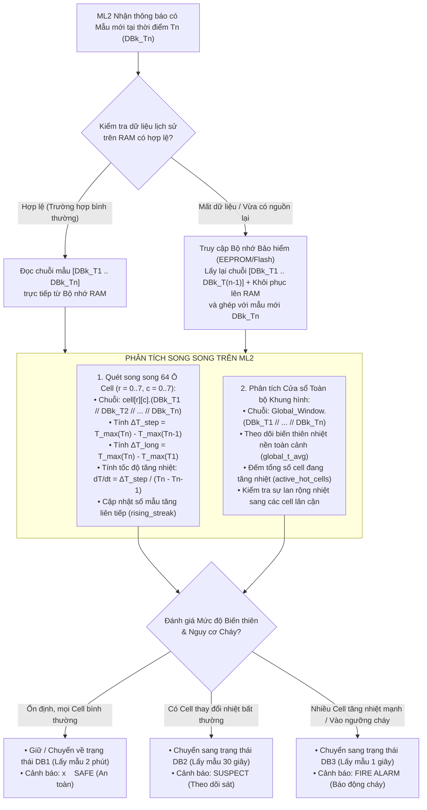

# TÀI LIỆU KIẾN TRÚC TỔNG THỂ HỆ THỐNG: CẦU NỐI CAMERA NHIỆT RTOS – TIỀN XỬ LÝ NPU1 (ML1) – LƯU TRỮ SONG SONG THEO MẪU THỜI GIAN ($\text{DB}_{k\_i}$) – PHÂN TÍCH BIẾN THIÊN NHIỆT NPU2 (ML2)

---

## MỤC LỤC
1. [Nguyên lý hoạt động tổng thể & Định nghĩa 3 Cơ sở dữ liệu theo thời gian ($\text{DB}_{k\_i}$)](#1-nguyên-lý-hoạt-động-tổng-thể--định-nghĩa-3-cơ-sở-dữ-liệu-theo-thời-gian-db_k_i)
2. [Nguyên lý phân tích chuỗi thời gian của ML2 (Từng Cell song song & Cửa sổ Toàn khung hình)](#2-nguyên-lý-phân-tích-chuỗi-thời-gian-của-ml2-từng-cell-song-song--cửa-sổ-toàn-khung-hình)
3. [Kiến trúc Lưu trữ Song song (RAM + Bộ nhớ Bảo hiểm EEPROM/Flash) & Cơ chế Xóa cũ thêm mới](#3-kiến-trúc-lưu-trữ-song-song-ram--bộ-nhớ-bảo-hiểm-eepromflash--cơ-chế-xóa-cũ-thêm-mới)
4. [Thiết kế Cấp phát Bộ nhớ trên RAM (RAM Memory Layout)](#4-thiết-kế-cấp-phát-bộ-nhớ-trên-ram-ram-memory-layout)
5. [Thiết kế Cấu trúc Dữ liệu (`Struct`) Tổng thể](#5-thiết-kế-cấu-trúc-dữ-liệu-struct-tổng-thể)
6. [Phân chia Tác vụ Từng Khối & Chức năng Chi tiết](#6-phân-chia-tác-vụ-từng-khối--chức-năng-chi-tiết)

---

## 1. NGUYÊN LÝ HOẠT ĐỘNG TỔNG THỂ & ĐỊNH NGHĨA 3 CƠ SỞ DỮ LIỆU THEO THỜI GIAN ($\text{DB}_{k\_i}$)

### 1.1. Định nghĩa Mẫu dữ liệu theo thời gian $\text{DB}_{k\_i}$
Hệ thống **không lưu cố định 5 mẫu**, mà lưu **từng mẫu rời rạc nối tiếp nhau theo mốc thời gian lấy mẫu thực tế $T_i$**:

$$\text{DB}_{k\_i} \equiv \text{DB}k\_T_i \quad \text{với } k \in \{1, 2, 3\},\; i \in \{1, 2, 3, \dots, N\}$$

Trong đó:
* **$k \in \{1, 2, 3\}$**: Cấp độ Cơ sở dữ liệu (Database trạng thái) tương ứng với mức độ cảnh giác của hệ thống.
* **$T_i$**: Thời điểm lấy mẫu thứ $i$ (được đánh dấu nhãn thời gian thực khi ML1 thu nhận khung hình từ cầu nối RTOS và trích xuất xong đặc trưng).
* Mỗi mẫu $\text{DB}_{k\_i}$ chứa trọn vẹn thông tin của **64 ô lưới (`cell[0][0]` $\dots$ `cell[7][7]`)** cùng với **1 Cửa sổ Toàn bộ Khung hình (`Global_Frame_Window`)** tại đúng thời điểm $T_i$.

---

### 1.2. Ba Cơ sở dữ liệu ($\text{DB}_1, \text{DB}_2, \text{DB}_3$) và Chu kỳ Lấy mẫu Động theo Trạng thái
Tần suất mà **ML1 (NPU1)** lấy mẫu từ Camera nhiệt, xử lý chia lưới và đẩy sang **ML2 (NPU2)** phân tích được điều chỉnh tự động theo **3 trạng thái vận hành**:

| Cơ sở dữ liệu | Trạng thái Hệ thống | Chu kỳ lấy mẫu ($\Delta t$) | Ký hiệu chuỗi mẫu theo thời gian | Mô tả điều kiện kích hoạt & Mục đích |
| :--- | :--- | :---: | :--- | :--- |
| **$\text{DB}_1$** | **1. Trạng thái Bình thường**<br/>*(Normal Monitoring)* | **2 phút / mẫu**<br/>($120\text{ giây}$) | $\text{DB1}\_T_1 \rightarrow \text{DB1}\_T_2 \rightarrow \dots \rightarrow \text{DB1}\_T_n$ | Môi trường nhiệt ổn định, không có đột biến. Hệ thống lấy mẫu thưa (2 phút/lần) đưa vào ML1 $\rightarrow$ ML2 để tiết kiệm năng lượng, giảm tải phần cứng và lưu được lịch sử dài hạn. |
| **$\text{DB}_2$** | **2. Sự kiện Nhiệt thay đổi Bất thường**<br/>*(Abnormal Thermal Event)* | **30 giây / mẫu** | $\text{DB2}\_T_1 \rightarrow \text{DB2}\_T_2 \rightarrow \dots \rightarrow \text{DB2}\_T_n$ | Khi ML2 phát hiện tốc độ tăng nhiệt hoặc độ chênh nhiệt tại $\ge 1$ ô cell (hoặc toàn khung) vượt ngưỡng biến thiên bình thường. Hệ thống lập tức rút ngắn chu kỳ lấy mẫu xuống 30 giây/lần để theo dõi xu hướng tăng nhiệt. |
| **$\text{DB}_3$** | **3. Ngưỡng Có thể Cháy & Lan rộng**<br/>*(Critical / Pre-Fire Mode)* | **1 giây / mẫu** | $\text{DB3}\_T_1 \rightarrow \text{DB3}\_T_2 \rightarrow \dots \rightarrow \text{DB3}\_T_n$ | Khi số lượng ô cell bất thường xuất hiện nhiều hơn và nhiệt độ theo thời gian đang tiến vào ngưỡng có thể cháy. Hệ thống lấy mẫu dày đặc mỗi 1 giây/lần để bắt kịp tốc độ bùng phát ngọn lửa theo thời gian thực. |

---

### 1.3. Sơ đồ Tổng thể Luồng Di chuyển Dữ liệu (End-to-End Dataflow Diagram)



---

### 1.4. Biểu đồ Máy trạng thái Chuyển đổi Chu kỳ Lấy mẫu ($\text{DB}_1 \leftrightarrow \text{DB}_2 \leftrightarrow \text{DB}_3$)



---

## 2. NGUYÊN LÝ PHÂN TÍCH CHUỖI THỜI GIAN CỦA ML2 (TỪNG CELL SONG SONG & CỬA SỔ TOÀN KHUNG HÌNH)

### 2.1. Cơ chế Đối chiếu Chuỗi Thời gian Song song trên 64 Ô Cell + 1 Cửa sổ Toàn khung hình
Khác với cách gom cứng một số lượng mẫu cố định, **ML2 không tự tính lại đặc trưng không gian từ ảnh thô**, mà nhận trực tiếp mẫu $\text{DB}_{k\_T_n}$ từ ML1, đánh dấu mốc thời gian lấy mẫu $T_n$, và **so sánh song song từng vị trí không gian tại thời điểm gần nhất ($T_n$) với chuỗi các thời điểm trước đó ($T_1, T_2, \dots, T_{n-1}$)**:

1. **64 Luồng Biến thiên Thời gian của 64 Ô Cell (`cell[0][0]` $\dots$ `cell[7][7]`)**:
   * Tại mỗi ô `cell[r][c]`, các mẫu theo thời gian được xếp thành một chuỗi lịch sử riêng biệt của chính ô đó:
     $$\text{cell}[r][c] : \quad \text{DB}_{k\_T_1} \longrightarrow \text{DB}_{k\_T_2} \longrightarrow \text{DB}_{k\_T_3} \longrightarrow \dots \longrightarrow \text{DB}_{k\_T_n}$$
   * Ví dụ với `cell[1][1]`:
     $$\text{cell}[1][1].(\text{DB}1\_T_1 \; // \; \text{DB}1\_T_2 \; // \; \text{DB}1\_T_3 \; // \dots // \; \text{DB}1\_T_n)$$
   * ML2 đặt giá trị tại thời điểm mới nhất $\text{cell}[r][c](\text{DB}_{k\_T_n})$ làm mốc đối chiếu trực tiếp với $\text{cell}[r][c](\text{DB}_{k\_T_{n-1}})$, $\text{cell}[r][c](\text{DB}_{k\_T_{n-2}})$, $\dots$, $\text{cell}[r][c](\text{DB}_{k\_T_1})$ để dựng lên **đường cong biến thiên nhiệt độ theo thời gian của riêng ô `cell[r][c]`**.

2. **1 Luồng Biến thiên Thời gian của Cửa sổ Toàn bộ Khung hình (`Global_Frame_Window`)**:
   * Song song với 64 ô cell cục bộ, toàn bộ khung hình $256 \times 192$ cũng có một cửa sổ tổng thể riêng:
     $$\text{Global\_Window}.(\text{DB}_{k\_T_1} \; // \; \text{DB}_{k\_T_2} \; // \; \text{DB}_{k\_T_3} \; // \dots // \; \text{DB}_{k\_T_n})$$
   * Cửa sổ toàn khung hình giúp ML2 theo dõi **nhiệt độ nền trung bình của cả căn phòng/khu vực ($T_{\text{global\_avg}}$)**, **nhiệt độ đỉnh toàn cảnh ($T_{\text{global\_max}}$)** và **tổng số lượng ô cell đang tăng nhiệt cùng lúc (`active_hot_cells`)**.
   * Nhờ kết hợp **64 Cell cục bộ + 1 Cửa sổ toàn khung**, ML2 dễ dàng phân biệt được:
     * **Trường hợp Môi trường nóng lên đồng đều** (ví dụ: buổi trưa nắng làm cả phòng ấm lên $2^\circ\text{C}$ $\rightarrow$ `Global_Window` tăng nhẹ đồng pha với tất cả 64 cell $\rightarrow$ **An toàn**).
     * **Trường hợp Điểm cháy cục bộ phát triển và lan rộng** (ví dụ: `cell[1][1]` tăng vọt đột biến so với chính nó ở $T_{n-1}, T_{n-2}$ và lệch hẳn so với `Global_Window`, sau đó lan sang `cell[1][2]`, `cell[2][1]` ở các mẫu tiếp theo $\rightarrow$ **Chuyển sang $\text{DB}_2 \rightarrow \text{DB}_3 \rightarrow$ Báo cháy**).

### 2.2. Sơ đồ Cấu trúc Chuỗi Thời gian Song song (64 Cells + 1 Global Window) trong ML2



### 2.3. Biểu đồ Minh họa Sự biến thiên Nhiệt độ theo Thời gian của một Cell (`cell[1][1]`) qua 3 Giai đoạn $\text{DB}_1 \rightarrow \text{DB}_2 \rightarrow \text{DB}_3$



---

### 2.4. Tham khảo thêm tính năng và đưa vào phần tính toán các tính năng của từng Cell (Review toàn cảnh & Rút gọn từ 7 tính năng)

> **Ghi chú thiết kế**: Phần dưới đây dùng để **tham khảo thêm tính năng và đưa vào phần tính toán các tính năng của từng cell (và cửa sổ toàn khung hình)**. Qua việc review lại toàn cảnh bài toán (Camera nhiệt lắp cố định, lấy mẫu theo 3 cấp độ thời gian $\text{DB}_1 = 2\text{ phút}$, $\text{DB}_2 = 30\text{ giây}$, $\text{DB}_3 = 1\text{ giây}$, ML2 so sánh chuỗi thời gian của từng cell song song), chúng ta thực hiện **sàng lọc 7 tính năng ban đầu xuống bộ tính năng rút gọn thiết yếu nhất**.

#### A. Bảng Đánh giá & Sàng lọc 7 Tính năng cho Bài toán Chuỗi Thời gian $\text{DB}_{k\_i}$

| STT | Tên Tính năng (Trong bộ 7 tính năng gốc) | Công thức | Đánh giá Phù hợp với Kiến trúc $\text{DB}_1 / \text{DB}_2 / \text{DB}_3$ | Quyết định |
| :---: | :--- | :---: | :--- | :---: |
| **1** | **Nhiệt độ cực đại ô ($T_{\text{max}}$)** | $\max_{(x,y) \in \text{cell}} T(x,y)$ | **Bắt buộc giữ (Tính tại ML1)**: Phản ánh trực tiếp điểm nóng nhất trong ô `cell[r][c]` tại thời điểm lấy mẫu $T_i$. Nếu chỉ dùng trung bình, một ngọn lửa nhỏ mới bùng phát trong ô $32\times 24$ pixel sẽ bị làm mờ. | **GIỮ LẠI (Cốt lõi #1)** |
| **2** | **Nhiệt độ trung bình ô ($T_{\text{avg}}$)** | $\frac{1}{768}\sum T(x,y)$ | **Bắt buộc giữ (Tính tại ML1)**: Cho biết mức nền nhiệt tích lũy của cả ô cell và dùng để đối chiếu khi đám cháy lan rộng lấp đầy ô cell. | **GIỮ LẠI (Cốt lõi #2)** |
| **3** | **Độ tương phản nhiệt nội ô ($\Delta T_{\text{spatial}}$)** | $T_{\text{max}} - T_{\text{avg}}$ | **Bắt buộc giữ (Tính tại ML1)**: Giúp phân biệt ngay lập tức **điểm phát nhiệt cục bộ** ($\Delta T$ lớn: ngọn lửa, chập điện) với **vật thể/mặt tường ấm lên đồng đều** ($\Delta T \approx 0$). | **GIỮ LẠI (Cốt lõi #3)** |
| **4** | **Độ biến thiên & Tốc độ tăng nhiệt theo thời gian ($\Delta T_{\text{time}}, \frac{dT}{dt}$)** | $\frac{T_{\text{max}}(T_n) - T_{\text{max}}(T_{n-m})}{T_n - T_{n-m}}$ | **Bắt buộc giữ (Trọng tâm của ML2)**: Đây chính là phép toán cốt lõi khi ML2 so sánh `cell[r][c].(DBk_Tn)` với `DBk_T(n-1)`, `DBk_T(n-2)`... Vì khoảng thời gian $\Delta t$ thay đổi giữa $\text{DB}_1 (120\text{s})$, $\text{DB}_2 (30\text{s})$, $\text{DB}_3 (1\text{s})$, chia cho $(T_n - T_{n-m})$ giúp chuẩn hóa tốc độ tăng nhiệt về cùng đơn vị $^\circ\text{C/giây}$. | **GIỮ LẠI (Cốt lõi #4)** |
| **5** | **Đếm số lần/thời gian duy trì vượt ngưỡng (`Persistence / Trend Count`)** | Số mẫu liên tiếp $\text{DB}_{k\_i}$ tăng nhiệt | **Bắt buộc giữ (Tính tại ML2)**: Xác nhận xu hướng nhiệt tăng liên tục qua nhiều mốc thời gian $T_1 \rightarrow T_2 \rightarrow T_3$, loại bỏ hoàn toàn nhiễu thoáng qua (như người đi ngang qua hoặc tia lửa hàn tắt ngay). | **GIỮ LẠI (Cốt lõi #5)** |
| **6** | **Gia tốc nhiệt bậc hai ($\frac{d^2T}{dt^2}$)** | $\frac{v_2 - v_1}{\Delta t}$ | **Loại bỏ / Rút gọn**: Khi hệ thống chuyển trạng thái giữa $\text{DB}_1 (120\text{s}) \rightarrow \text{DB}_2 (30\text{s}) \rightarrow \text{DB}_3 (1\text{s})$, bước nhảy thời gian $\Delta t$ không đều nhau khiến đạo hàm bậc 2 bị vọt lố số học (numerical spike) và nhạy với nhiễu. Chỉ cần dùng tốc độ bậc 1 ($\frac{dT}{dt}$) kết hợp chuỗi so sánh nhiều mốc $T_{n} > T_{n-1} > T_{n-2}$ là đã đủ chính xác và ổn định hơn. | **LOẠI BỎ** *(Thay bằng chuỗi so sánh đơn điệu)* |
| **7** | **Gradient không gian lân cận ($\|\nabla T\|$) & Phương sai ($\sigma^2$)** | $\|T_{r,c} - T_{r,c\pm 1}\|$ | **Rút gọn vào Cửa sổ Toàn khung hình (`Global_Frame_Window`)**: Không cần tính $\|\nabla T\|$ phức tạp cho từng cặp cell. Thay vào đó, chỉ cần so sánh $T_{\text{max}}$ của từng cell với $T_{\text{global\_avg}}$ của **Cửa sổ Toàn khung hình** và đếm số lượng cell vượt ngưỡng (`active_hot_cells`). | **RÚT GỌN VÀO CỬA SỔ TOÀN KHUNG** |


#### B. Kết luận Bộ Tính năng Rút gọn Tối ưu cho Từng Cell & Cửa sổ Toàn khung
Như vậy, thay vì gánh cả 7 tính năng phức tạp, mỗi mẫu $\text{DB}_{k\_i}$ và bộ phân tích ML2 chỉ cần tập trung vào **2 nhóm thông số tinh gọn và hiệu quả nhất**:
1. **Tại mỗi Ô `cell[r][c]` trong mẫu $\text{DB}_{k\_i}$ (Do NPU1/ML1 xuất ra)**:
   * `T_avg` (Nhiệt độ trung bình ô)
   * `T_max` (Nhiệt độ cực đại ô)
   * `Delta_T` ($= T_{\text{max}} - T_{\text{avg}}$, Độ tương phản cục bộ trong ô)
2. **Khi ML2 đối chiếu chuỗi thời gian `cell[r][c].(DBk_T1 // DBk_T2 // ... // DBk_Tn)` và `Global_Window`**:
   * **Độ lệch nhiệt theo thời gian**: $\Delta T_{\text{step}} = T_{\text{max}}(T_n) - T_{\text{max}}(T_{n-1})$ và $\Delta T_{\text{long}} = T_{\text{max}}(T_n) - T_{\text{max}}(T_1)$.
   * **Tốc độ biến thiên chuẩn hóa**: $R_{\text{rise}} = \frac{T_{\text{max}}(T_n) - T_{\text{max}}(T_{n-1})}{T_n - T_{n-1}}$ ($^\circ\text{C/s}$).
   * **Độ lệch so với Cửa sổ Toàn khung**: $\Delta T_{\text{scene}} = T_{\text{max}}(\text{cell}[r][c], T_n) - T_{\text{global\_avg}}(T_n)$ kèm số lượng ô đang nóng lên đồng thời (`hot_cell_count`).

---

## 3. KIẾN TRÚC LƯU TRỮ SONG SONG (RAM + BỘ NHỚ BẢO HIỂM EEPROM/FLASH) & CƠ CHẾ XÓA CŨ THÊM MỚI

### 3.1. Nguyên lý Lưu trữ Song song Đúng theo Yêu cầu Thiết kế
Trong kiến trúc này, khái niệm **"Lưu trữ song song" (Parallel Storage)** được định nghĩa rõ ràng theo đúng vai trò của 2 tầng bộ nhớ:

1. **Bộ nhớ RAM (Primary Active Storage - Phục vụ trực tiếp cho ML2)**:
   * Là nơi lưu trữ chính của các chuỗi mẫu $\text{DB}_1, \text{DB}_2, \text{DB}_3$.
   * Trong suốt quá trình hệ thống hoạt động bình thường, **ML2 chỉ truy cập trực tiếp vào RAM** để đọc các mẫu $\text{DB}_{k\_T_1} \dots \text{DB}_{k\_T_n}$ và dựng biểu đồ so sánh theo thời gian với tốc độ tức thời.
2. **Bộ nhớ Bảo hiểm Không mất dữ liệu (EEPROM / Non-Volatile Flash Insurance Backup)**:
   * Đóng vai trò **Bảo hiểm dữ liệu (Data Insurance)** phòng trường hợp hệ thống bị mất nguồn đột ngột, sụt áp reset hoặc lỗi mất dữ liệu trên RAM.
   * Mỗi khi ML1 tạo ra một mẫu mới $\text{DB}_{k\_T_i}$, mẫu này được **ghi song song cùng lúc vào cả RAM lẫn Bộ nhớ Bảo hiểm (EEPROM/Flash)**.
   * *(Lưu ý thực tế phần cứng: Nếu bo mạch chưa gắn chip EEPROM rời qua I2C/SPI, vùng Bảo hiểm này được ánh xạ trực tiếp vào phân vùng Non-Volatile Flash cố định trên bo mạch với cơ chế truy xuất theo bản ghi giống hệt EEPROM).*

---

### 3.2. Sơ đồ Cách ML2 Lấy Dữ liệu ở Các Trường hợp Vận hành

#### Trường hợp 1: Hệ thống Hoạt động Bình thường (Normal Online Operation)
* **Luồng ghi của ML1**: Ghi song song mẫu $\text{DB}_{k\_T_i}$ vào cả **RAM** và **EEPROM/Flash Bảo hiểm**.
* **Luồng đọc của ML2**: ML2 **lấy dữ liệu trực tiếp từ RAM** (không cần đọc từ EEPROM/Flash, giúp tốc độ phân tích chuỗi thời gian của 64 cell đạt mức tối đa).



---

#### Trường hợp 2: Mất nguồn / Khởi động lại hoặc Mất dữ liệu RAM (Power Loss / RAM Data Loss Recovery)
* **Tình huống**: Thiết bị vừa trải qua sự cố mất điện rồi có nguồn trở lại (hoặc tiến trình bị khởi động lại khiến dữ liệu trong RAM bị xóa trắng), trong khi trước lúc mất điện hệ thống đang theo dõi chuỗi nhiệt $\text{DB}_{k\_T_1} \dots \text{DB}_{k\_T_{n-1}}$.
* **Cách ML2 lấy dữ liệu**:
  1. Khi khởi động hoặc trước khi phân tích mẫu mới $\text{DB}_{k\_T_n}$, ML2 kiểm tra vùng nhớ RAM thấy trống (`ram_valid_count == 0` hoặc mất chữ ký `magic`).
  2. **ML2 lập tức chuyển hướng sang đọc chuỗi lịch sử $\text{DB}_{k\_T_1} \dots \text{DB}_{k\_T_{n-1}}$ từ Bộ nhớ Bảo hiểm (EEPROM/Flash)**, đồng thời nạp (khôi phục) lại chuỗi lịch sử đó vào RAM.
  3. Khi ML1 đưa mẫu đầu tiên sau khi có điện ($\text{DB}_{k\_T_n}$) vào, **ML2 ghép nối ngay $\text{DB}_{k\_T_n}$ với lịch sử $\text{DB}_{k\_T_1} \dots \text{DB}_{k\_T_{n-1}}$ vừa lấy từ Bảo hiểm** để phân tích liên tục mà không bị đứt đoạn biểu đồ nhiệt!



---

#### Trường hợp 3: Chuyển đổi Trạng thái giữa $\text{DB}_1 (2\text{p}) \leftrightarrow \text{DB}_2 (30\text{s}) \leftrightarrow \text{DB}_3 (1\text{s})$
* Khi ML2 quyết định chuyển từ trạng thái bình thường ($\text{DB}_1$) sang bất thường ($\text{DB}_2$) hoặc nguy cơ cháy ($\text{DB}_3$):
  * Mẫu cuối cùng của trạng thái trước (ví dụ $\text{DB1}\_T_{\text{last}}$) được dùng làm **mốc tham chiếu gốc ($T_0$)** cho chuỗi mẫu của trạng thái mới ($\text{DB2}\_T_1$), giúp ML2 không bao giờ mất điểm gốc ban đầu khi đổi tốc độ lấy mẫu.



---

### 3.3. Phương pháp Lưu trữ khi Đầy Dung lượng: Xóa 1 Dữ liệu Cũ nhất để Thêm 1 Dữ liệu Mới (FIFO Circular Eviction)

Khi hệ thống chạy liên tục trong thời gian dài, vùng nhớ dành cho $\text{DB}_1, \text{DB}_2, \text{DB}_3$ trên cả **RAM** và **Bộ nhớ Bảo hiểm (EEPROM/Flash)** sẽ tiến tới giới hạn dung lượng tối đa ($N_{\max}$ mẫu cho mỗi DB).

Để hệ thống hoạt động vĩnh viễn mà không bao giờ bị tràn bộ nhớ, phương pháp quản lý dung lượng được thiết kế theo cơ chế **Cuốn chiếu FIFO (First-In, First-Out Circular Ring Buffer — Xóa 1 mẫu cũ nhất để ghi đè 1 mẫu mới nhất)**:

1. **Nguyên lý Con trỏ Vòng (`head_idx`, `tail_idx`, `count`)**:
   * Giả sử mỗi Database $\text{DB}_k$ được cấp phát cố định tối đa $N_{\max}$ ô nhớ mẫu (Slot $0, 1, \dots, N_{\max}-1$).
   * **Khi chưa đầy (`count < N_max`)**:
     * Mẫu mới $\text{DB}_{k\_T_i}$ được ghi vào vị trí `head_idx`.
     * Tăng `head_idx = (head_idx + 1) % N_max` và tăng `count++`.
   * **Khi sắp hết / đã đạt ngưỡng dung lượng (`count == N_max`)**:
     * **Bước 1 (Xóa/Thu hồi 1 mẫu cũ nhất)**: Mẫu cũ nhất hiện đang nằm tại con trỏ `tail_idx` (tức $\text{DB}_{k\_T_{\text{oldest}}}$) được đánh dấu thu hồi; dịch con trỏ mẫu cũ nhất sang mẫu kế tiếp: `tail_idx = (tail_idx + 1) % N_max`.
     * **Bước 2 (Ghi mẫu mới nhất vào đúng vị trí vừa giải phóng)**: Ghi mẫu mới $\text{DB}_{k\_T_{\text{new}}}$ vào vị trí `head_idx` (chính là ô nhớ vừa được giải phóng của mẫu cũ nhất), sau đó cập nhật `head_idx = (head_idx + 1) % N_max`. Số lượng mẫu `count` giữ nguyên ở mức tối đa $N_{\max}$.
2. **Lợi ích trên cả RAM và EEPROM/Flash**:
   * **Không tốn thao tác dịch chuyển mảng (`memmove`)**: Chỉ cần dịch chuyển con trỏ `tail_idx` và ghi đè tại `head_idx` với độ phức tạp $O(1)$.
   * **Cân bằng độ hao mòn tự nhiên (Natural Wear-Leveling) cho EEPROM/Flash**: Vì con trỏ `head_idx` chạy vòng tròn từ Slot $0 \rightarrow N_{\max}-1$ rồi mới quay lại Slot $0$, mọi ô nhớ trong EEPROM/Flash đều có số lần xóa/ghi đồng đều nhau, kéo dài tối đa tuổi thọ phần cứng.

#### Sơ đồ Minh họa Quá trình Xóa 1 Dữ liệu Cũ để Thêm 1 Dữ liệu Mới khi Đầy Bộ nhớ



```
MINH HỌA TRẠNG THÁI BỘ ĐỆM VÒNG (VÍ DỤ N_max = 6 MẪU):

[Trước khi thêm mẫu thứ 7 - Bộ nhớ đã đầy 6/6 mẫu]:
  Slot:   [  0  ]   [  1  ]   [  2  ]   [  3  ]   [  4  ]   [  5  ]
  Dữ liệu: DBk_T1    DBk_T2    DBk_T3    DBk_T4    DBk_T5    DBk_T6
             ^                                                 ^
          tail_idx (Cũ nhất)                               Mẫu mới nhất (head_idx = 0)

[Khi mẫu mới DBk_T7 tới -> Xóa DBk_T1 tại Slot[0], ghi DBk_T7 vào Slot[0], dịch tail_idx sang Slot[1]]:
  Slot:   [  0  ]   [  1  ]   [  2  ]   [  3  ]   [  4  ]   [  5  ]
  Dữ liệu: DBk_T7    DBk_T2    DBk_T3    DBk_T4    DBk_T5    DBk_T6
             ^         ^
         Mới nhất   tail_idx (Mẫu cũ nhất hiện tại là DBk_T2)
```

---

## 4. THIẾT KẾ CẤP PHÁT BỘ NHỚ TRÊN RAM (RAM MEMORY LAYOUT)

Dựa trên toàn bộ các khối chức năng (Cầu nối RTOS $\rightarrow$ NPU1 $\rightarrow$ Lưu trữ RAM cho $\text{DB}_1, \text{DB}_2, \text{DB}_3$ $\rightarrow$ Phân tích chuỗi thời gian 64 Cells + 1 Global Window của NPU2), chúng ta tính toán kích thước thực tế và thiết kế **RAM Memory Layout** tối ưu, hoàn toàn nằm gọn trong vùng nhớ chia sẻ / bộ nhớ ứng dụng của SoC **SG2002 (64 MB / 256 MB SiP DRAM)**:

### 4.1. Tính toán Kích thước của 1 Mẫu Thời gian $\text{DB}_{k\_i}$
Mỗi mẫu $\text{DB}_{k\_i}$ lưu trữ tại thời điểm $T_i$ gồm:
1. **Header & Cửa sổ Toàn khung hình (`Global_Frame_Window`)**:
   * Nhãn thời gian `timestamp_ms` (8B), số thứ tự mẫu `sample_seq` (4B), mã `db_type` (1B), trạng thái màn trập/gain (3B).
   * Thông số **Cửa sổ Toàn khung hình**: `global_t_avg` (4B), `global_t_max` (4B), `global_t_min` (4B), `global_delta_t` (4B), tọa độ điểm nóng toàn khung `global_max_x, global_max_y` (4B), số lượng cell vượt ngưỡng `active_hot_cells` (2B), nhiệt độ nội cảm biến `vtemp` (2B), dự phòng/CRC (8B).
   * $\Rightarrow$ **Tổng Header + Cửa sổ Toàn khung = `48 Bytes`**.
2. **Dữ liệu của 64 Ô Cell (`cell[8][8]`)**:
   * Mỗi ô `cell[r][c]` lưu 3 thông số rút gọn: `T_avg` (4B `float`), `T_max` (4B `float`), `Delta_T` (4B `float`) = **12 Bytes / cell**.
   * Với $8 \times 8 = 64$ ô cell: $64 \times 12\text{ Bytes} = \mathbf{768\text{ Bytes}}$.
3. **Tổng kích thước 1 mẫu $\text{DB}_{k\_i}$**:
   $$\text{Size}(\text{DB}_{k\_i}) = 48\text{ Bytes (Global Window + Metadata)} + 768\text{ Bytes (64 Cells)} = \mathbf{816\text{ Bytes}} \quad (\text{Căn chỉnh 64-byte Cache Line thành } \mathbf{832\text{ Bytes / mẫu}})$$

---

### 4.2. Quy hoạch Số lượng Mẫu & Dung lượng cho $\text{DB}_1, \text{DB}_2, \text{DB}_3$ trên RAM
Với kích thước chỉ **832 Bytes / mẫu**, chúng ta có thể cấp phát dư dả cho cả 3 Database trên RAM mà tổng dung lượng vẫn cực kỳ nhỏ gọn:

| Vùng Lưu trữ DB | Chu kỳ lấy mẫu ($\Delta t$) | Số mẫu tối đa ($N_{\max}$) | Thời gian lịch sử bao phủ | Dung lượng trên RAM ($N_{\max} \times 832\text{ B}$) |
| :--- | :---: | :---: | :---: | :---: |
| **$\text{DB}_1$ (Bình thường)** | $2\text{ phút}$ ($120\text{s}$) | **120 mẫu** | **4 Giờ** liên tục | $\approx \mathbf{99.8\text{ KB}}$ (Cấp tròn **128 KB**) |
| **$\text{DB}_2$ (Thay đổi bất thường)** | $30\text{ giây}$ | **120 mẫu** | **1 Giờ** liên tục | $\approx \mathbf{99.8\text{ KB}}$ (Cấp tròn **128 KB**) |
| **$\text{DB}_3$ (Ngưỡng có thể cháy)** | $1\text{ giây}$ | **300 mẫu** | **5 Phút** liên tục từng giây | $\approx \mathbf{249.6\text{ KB}}$ (Cấp tròn **256 KB**) |
| **Tổng cộng 3 DB ($\text{DB}_1 + \text{DB}_2 + \text{DB}_3$)** | — | **540 mẫu** | — | **512 KB** (`0.5 MB`) |

> **Nhận xét**: Chỉ với **512 KB RAM**, hệ thống lưu được trọn vẹn **4 giờ** lịch sử bình thường ($\text{DB}_1$), **1 giờ** lịch sử sự kiện bất thường ($\text{DB}_2$) và **5 phút** lịch sử chi tiết từng giây ($\text{DB}_3$) cho toàn bộ **64 ô cell + 1 cửa sổ toàn khung hình**!
> Đối với **Bộ nhớ Bảo hiểm (EEPROM/Flash)**:
> * Nếu dùng Flash/SD/NOR Flash: Có thể mirror nguyên vẹn cả 512 KB này.
> * Nếu dùng chip EEPROM rời dung lượng nhỏ (ví dụ EEPROM 64 KB / 128 KB): Chỉ cần cấu hình `N_max_eeprom` giữ 16~32 mẫu gần nhất cho mỗi DB (chỉ tốn $32 \times 832\text{ B} \approx 26\text{ KB}$ / DB) là hoàn toàn đủ để ML2 khôi phục lại biểu đồ xu hướng nhiệt ngay sau khi mất điện.

---

### 4.3. Sơ đồ Bản đồ Bộ nhớ trên RAM (RAM Memory Map Layout - Tổng cộng `1.0 MB`)

Toàn bộ không gian bộ nhớ dùng chung và xử lý nhiệt (từ Cầu nối RTOS đến NPU1, 3 Database $\text{DB}_1/\text{DB}_2/\text{DB}_3$ và không gian phân tích của ML2) được quy hoạch gọn trong **1 MB RAM** (ví dụ từ `0x8FE00000` đến `0x8FF00000`):



---

## 5. THIẾT KẾ CẤU TRÚC DỮ LIỆU (`STRUCT`) TỔNG THỂ

Các `struct` dưới đây biểu diễn trọn vẹn cấu trúc dữ liệu của hệ thống theo đúng định nghĩa mẫu thời gian $\text{DB}_{k\_i}$, chuỗi biến thiên của từng `cell[r][c]`, cửa sổ toàn khung hình `Global_Frame_Window`, và bộ đệm vòng FIFO xóa cũ thêm mới:

# `Đang phát triển`
<!-- ```c
#include <stdint.h>
#include <stdbool.h>

#define GRID_ROWS               (8)
#define GRID_COLS               (8)
#define TOTAL_CELLS             (64)

#define DB1_MAX_SAMPLES         (120)   /* 120 mẫu × 2 phút = 4 giờ */
#define DB2_MAX_SAMPLES         (120)   /* 120 mẫu × 30 giây = 1 giờ */
#define DB3_MAX_SAMPLES         (300)   /* 300 mẫu × 1 giây  = 5 phút */

/* 1. Định nghĩa 3 loại Cơ sở dữ liệu theo trạng thái lấy mẫu */
typedef enum {
    DB_STATE_1_NORMAL           = 1,    /* Chu kỳ lấy mẫu: 120 giây (2 phút) */
    DB_STATE_2_ABNORMAL         = 2,    /* Chu kỳ lấy mẫu: 30 giây */
    DB_STATE_3_CRITICAL_FIRE    = 3     /* Chu kỳ lấy mẫu: 1 giây */
} db_sampling_state_t;

/* 2. Đặc trưng Rút gọn của 1 Ô Cell tại một thời điểm lấy mẫu Ti (12 Bytes) */
typedef struct {
    float    t_avg;                     /* Nhiệt độ trung bình của ô cell (°C) */
    float    t_max;                     /* Nhiệt độ cực đại của ô cell (°C) */
    float    delta_t;                   /* Độ tương phản nội ô: t_max - t_avg (°C) */
} __attribute__((packed)) cell_feature_t;

/* 3. Cửa sổ Toàn bộ Khung hình tại một thời điểm lấy mẫu Ti (Global Frame Window - 28 Bytes) */
typedef struct {
    float    global_t_avg;              /* Nhiệt độ nền trung bình toàn khung 256×192 (°C) */
    float    global_t_max;              /* Nhiệt độ đỉnh cao nhất toàn khung (°C) */
    float    global_t_min;              /* Nhiệt độ thấp nhất toàn khung (°C) */
    float    global_delta_t;            /* Độ chênh nhiệt toàn khung: global_t_max - global_t_avg */
    uint16_t global_max_x;              /* Tọa độ pixel X của điểm nóng nhất toàn khung */
    uint16_t global_max_y;              /* Tọa độ pixel Y của điểm nóng nhất toàn khung */
    uint8_t  hotspot_cell_row;          /* Hàng của ô cell nóng nhất [0..7] */
    uint8_t  hotspot_cell_col;          /* Cột của ô cell nóng nhất [0..7] */
    uint8_t  active_hot_cells;          /* Tổng số ô cell đang vượt ngưỡng nhiệt trong khung (0..64) */
    uint8_t  reserved;
    uint16_t sensor_vtemp;              /* Nhiệt độ nội cảm biến tại thời điểm lấy mẫu */
    uint16_t shutter_gain_flags;        /* Cờ trạng thái màn trập và chế độ Gain */
} __attribute__((packed)) global_window_feature_t;

/* 4. Cấu trúc của 1 Mẫu Thời gian DBk_i (tức DBk_Ti) do ML1 tạo ra (Căn chỉnh chuẩn 832 Bytes) */
typedef struct {
    uint32_t                magic;          /* 0x44424B49 ('DBKI') */
    uint8_t                 db_id;          /* 1: DB1 (2p), 2: DB2 (30s), 3: DB3 (1s) */
    uint8_t                 valid;          /* 1 = Mẫu hợp lệ */
    uint16_t                sampling_dt_s;  /* Chu kỳ lấy mẫu tại thời điểm này (120s / 30s / 1s) */
    uint32_t                sample_seq;     /* Chỉ số i của mẫu (DBk_1, DBk_2, ..., DBk_i) */
    uint64_t                timestamp_ms;   /* Thời điểm lấy mẫu Ti (ms) */

    /* A. Cửa sổ Toàn bộ Khung hình tại thời điểm Ti */
    global_window_feature_t global_win;

    /* B. Ma trận 64 Ô Cell tại thời điểm Ti:
     * Truy cập ô [r][c] tại mẫu này: sample.cells[r][c] */
    cell_feature_t          cells[GRID_ROWS][GRID_COLS]; /* 64 × 12 = 768 Bytes */

    uint32_t                crc32;          /* Mã kiểm tra toàn vẹn của mẫu DBk_i */
    uint8_t                 padding[12];    /* Căn chỉnh chẵn 832 Bytes (13 × 64B Cache Line) */
} __attribute__((packed, aligned(64))) db_time_sample_t;

/* 5. Cấu trúc Hàng đợi Vòng FIFO cho từng Database (Hỗ trợ Xóa 1 mẫu cũ nhất để thêm mẫu mới) */
typedef struct {
    uint32_t            magic;              /* 0x52494E47 ('RING') */
    uint8_t             db_id;              /* DB1, DB2 hoặc DB3 */
    uint8_t             reserved[3];
    uint32_t            max_capacity;       /* Dung lượng tối đa (VD: 120 hoặc 300 mẫu) */
    uint32_t            count;              /* Số lượng mẫu hiện có trong DB (0 .. max_capacity) */
    uint32_t            head_idx;           /* Vị trí sẽ ghi mẫu mới tiếp theo */
    uint32_t            tail_idx;           /* Vị trí của mẫu CŨ NHẤT (sẽ bị xóa khi count == max_capacity) */
    uint32_t            total_pushed;       /* Tổng số mẫu đã từng đẩy vào từ lúc chạy */
    uint32_t            crc32;              /* CRC của Header quản lý Ring Buffer */
} __attribute__((packed)) db_ring_header_t;

/* 6. Cấu trúc Tổng thể Lưu trữ trên RAM cho cả 3 Database (DB1, DB2, DB3) */
typedef struct {
    uint32_t            system_magic;       /* 0x54484442 ('THDB') */
    db_sampling_state_t current_state;      /* Trạng thái lấy mẫu hiện tại (DB1 / DB2 / DB3) */
    uint64_t            last_sample_time_ms;/* Mốc thời gian lấy mẫu gần nhất */

    /* DB1: Trạng thái bình thường (Chu kỳ 2 phút) */
    db_ring_header_t    db1_hdr;
    db_time_sample_t    db1_samples[DB1_MAX_SAMPLES];

    /* DB2: Sự kiện nhiệt thay đổi bất thường (Chu kỳ 30 giây) */
    db_ring_header_t    db2_hdr;
    db_time_sample_t    db2_samples[DB2_MAX_SAMPLES];

    /* DB3: Ngưỡng có thể cháy (Chu kỳ 1 giây) */
    db_ring_header_t    db3_hdr;
    db_time_sample_t    db3_samples[DB3_MAX_SAMPLES];
} __attribute__((packed, aligned(64))) ram_parallel_db_store_t;

/* 7. Cấu trúc Kết quả Phân tích Chuỗi Thời gian của Từng Cell & Toàn khung trên ML2 */
typedef struct {
    /* Kết quả phân tích biến thiên theo thời gian cho từng ô cell[r][c] */
    struct {
        float           latest_t_max;       /* T_max tại thời điểm gần nhất Tn */
        float           latest_t_avg;       /* T_avg tại thời điểm gần nhất Tn */
        float           latest_delta_t;     /* Độ tương phản nội ô tại Tn */
        float           temp_diff_prev;     /* Độ chênh so với mẫu liền trước: T(Tn) - T(Tn-1) */
        float           temp_diff_base;     /* Độ chênh so với mẫu gốc đầu chuỗi: T(Tn) - T(T1) */
        float           rise_rate_c_per_s;  /* Tốc độ biến thiên nhiệt theo thời gian (°C/s) */
        uint16_t        rising_streak;      /* Số mẫu liên tiếp nhiệt độ tăng lên tại ô này */
        uint8_t         cell_risk_level;    /* 0: Bình thường, 1: Bất thường (DB2), 2: Nguy cơ cháy (DB3) */
        uint8_t         reserved;
    } cell_timeline[GRID_ROWS][GRID_COLS];

    /* Kết quả phân tích biến thiên trên Cửa sổ Toàn bộ Khung hình */
    struct {
        float           scene_t_avg_latest; /* Nhiệt độ trung bình toàn khung tại Tn */
        float           scene_t_max_latest; /* Nhiệt độ cực đại toàn khung tại Tn */
        float           scene_rise_rate;    /* Tốc độ biến thiên nhiệt nền toàn khung (°C/s) */
        uint8_t         hot_cell_count;     /* Số lượng ô cell đang ở mức bất thường/nguy hiểm */
        uint8_t         spreading_detected; /* 1 = Phát hiện nhiệt đang lan từ 1 cell sang các cell lân cận */
    } global_timeline;

    /* Quyết định điều phối của ML2 */
    db_sampling_state_t next_sampling_state;/* Trạng thái chu kỳ lấy mẫu tiếp theo (DB1: 2p, DB2: 30s, DB3: 1s) */
    uint8_t             alarm_status;       /* 0: SAFE, 1: SUSPECT, 2: FIRE ALARM */
    bool                data_from_backup;   /* true = Chuỗi lịch sử vừa được ML2 lấy từ Bảo hiểm EEPROM */
} ml2_timeline_analysis_t;
``` -->

---

## 6. PHÂN CHIA TÁC VỤ TỪNG KHỐI & CHỨC NĂNG CHI TIẾT

### 6.1. Bảng Phân nhiệm Tác vụ Từng Khối trong Hệ thống

| Tên Khối | Vai trò cốt lõi | Tác vụ chi tiết |
| :--- | :--- | :--- |
| **1. Khối Cầu nối Giao tiếp RTOS**<br/>*(Core RTOS Bridge)* | Cầu nối phần cứng thuần túy giữa Camera và CPU chính | • **Không chia lưới hay gom cụm**.<br>• Thu nhận khung hình nhiệt/ảnh nguyên bản qua giao tiếp SPI từ camera và đặt vào vùng nhớ RAM chia sẻ.<br>• Nhận lệnh từ CPU chính và phát lệnh I2C xuống camera để điều khiển: Chế độ luồng, Màn trập NUC/FFC, Đo nhiệt TPD, **Tính năng 5 (ISP: Bảng màu, Zoom, Lọc nhiễu)** và **Tính năng 6 (Hiệu chuẩn: Điểm chết DPC, Xóa viền, Hiệu chuẩn 1-2 điểm, Bù môi trường)**. |
| **2. Khối Điều phối Lấy mẫu Động**<br/>*(Dynamic Sampling Scheduler)* | Quản lý thời gian kích hoạt ML1 theo 3 trạng thái | • Duy trì bộ đếm thời gian lấy mẫu dựa trên trạng thái do ML2 quyết định:<br>  + Trạng thái $\text{DB}_1$: Đợi đủ **2 phút (120s)** mới lấy 1 khung hình đưa vào ML1.<br>  + Trạng thái $\text{DB}_2$: Đợi đủ **30 giây** lấy 1 khung hình đưa vào ML1.<br>  + Trạng thái $\text{DB}_3$: Mỗi **1 giây** lấy 1 khung hình đưa vào ML1. |
| **3. Khối Tiền xử lý Không gian NPU1**<br/>*(ML1 Spatial Feature Extractor)* | Trích xuất 64 Ô Cell + 1 Cửa sổ Toàn khung tại thời điểm $T_i$ | • Nhận khung hình RAW16 $256 \times 192$ tại thời điểm lấy mẫu $T_i$ (lọc bỏ nếu màn trập đang đóng).<br>• Chạy trên phần cứng NPU: Quy đổi độ C và thực hiện Pooling 2 tầng (`192×256` $\rightarrow$ `64×64` $\rightarrow$ `8×8`).<br>• Tính 3 đặc trưng cốt lõi (`T_avg`, `T_max`, `Delta_T`) cho từng ô `cell[r][c]` và tính các thông số cho **Cửa sổ Toàn khung hình (`Global_Frame_Window`)**.<br>• Đóng gói thành 1 mẫu hoàn chỉnh $\text{DB}_{k\_i}$ (`832 Bytes`). |
| **4. Khối Lưu trữ Song song & Quản lý Dung lượng**<br/>*(Parallel RAM + EEPROM Backup Manager)* | Lưu trữ song song & Thu hồi mẫu cũ khi đầy | • **Ghi song song**: Khi nhận mẫu $\text{DB}_{k\_i}$ từ ML1, ghi vào **RAM Ring Buffer** đồng thời ghi bản sao bảo hiểm vào **EEPROM / Non-Volatile Flash**.<br>• **Xử lý khi đầy bộ nhớ**: Kiểm tra nếu `count == max_capacity` thì tự động **xóa 1 mẫu cũ nhất (`tail_idx`)** trước khi ghi đè mẫu mới nhất (`head_idx`).<br>• **Cung cấp dữ liệu**: Phục vụ dữ liệu từ RAM cho ML2 khi chạy bình thường, và tự động cung cấp dữ liệu từ EEPROM/Flash cho ML2 khi mất nguồn/mất dữ liệu RAM. |
| **5. Khối Phân tích Chuỗi Thời gian NPU2**<br/>*(ML2 Parallel Timeline Analyzer)* | So sánh biến thiên theo thời gian của từng Cell & Toàn khung | • Đánh dấu thời điểm lấy mẫu $T_n$, lấy chuỗi lịch sử $\text{DB}_{k\_T_1} \dots \text{DB}_{k\_T_n}$ (từ RAM, hoặc từ Bảo hiểm EEPROM nếu RAM mất dữ liệu).<br>• Thực hiện **so sánh song song từng ô `cell[r][c]`** tại $T_n$ với các mẫu trước đó của chính ô đó (`cell[r][c].(DBk_T1 // DBk_T2 // ... // DBk_Tn)`) để dựng biểu đồ biến thiên nhiệt theo thời gian.<br>• Phân tích song song **Cửa sổ Toàn bộ Khung hình** để đánh giá nền nhiệt chung và sự lan truyền nhiệt giữa các ô.<br>• Quyết định chuyển trạng thái lấy mẫu ($\text{DB}_1 \leftrightarrow \text{DB}_2 \leftrightarrow \text{DB}_3$) và phát cảnh báo cháy. |

---

### 6.2. Sơ đồ Tổng hợp Toàn bộ Luồng Xử lý của ML2 đối với Từng Cell, Cửa sổ Toàn khung và Điều khiển Trạng thái


